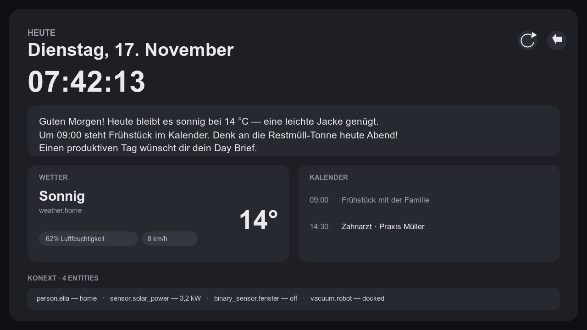

# Day Brief Card

AI-first Home Assistant Lovelace card for today: weather, meetings, household context, and a short narrative brief.




## Install (HACS)

1. HACS → **Frontend** → ⋮ → **Custom repositories**
2. Add `https://github.com/jenskock/lovelace-day-brief` as category **Lovelace**
3. Install **Day Brief Card**
4. Reload the browser (clear cache if needed)

Manual resource (YAML mode):

```yaml
resources:
  - url: /hacsfiles/lovelace-day-brief/day-brief.js
    type: module
```

## Usage

Personal details (names, birthdays, pets) belong in **card config**, not in the shared source.

```yaml
type: custom:day-brief-card
weather_entity: weather.home
calendars:
  - calendar.family
  - calendar.birthdays
entities:
  - person.alex
  - person.sam
  - sensor.solar_power
  - sensor.trash_residual
  - binary_sensor.living_room_window
  - sensor.heating_oil
  - vacuum.robot
context_notes: |
  Family members, pets, school notes…
birthdays:
  - name: Alex
    date: "1990-04-30"
  - name: Sam
    date: "2018-12-28"
forecast_type: daily
horizon_hours: 24
summary_mode: auto
cache_minutes: 15
agent_id: conversation.your_llm_agent
```

### Options

| Option | Type | Default | Description |
|---|---|---|---|
| `weather_entity` | string | — | Weather entity for current conditions |
| `calendars` | string[] | `[]` | Calendar entities for today’s agenda |
| `entities` | string[] | `[]` | Extra HA entities (people, solar, trash, windows, oil, vacuum/mower, …) |
| `cameras` | string[] | `[]` | Camera entities shown as feeds at the bottom — MJPEG stream when available, automatic fallback to refreshed still snapshots (badge shows Live/Snapshot) |
| `mic_test` | boolean | `false` | Microphone test panel: tap to request mic access (`getUserMedia`) with a live level meter — shows whether the dashboard browser (e.g. Echo Show Silk) allows mic input |
| `birthdays` | `{name,date}[]` | `[]` | Birthdays as `YYYY-MM-DD`; surfaced if within 14 days |
| `schedules` | object[] | `[]` | School/work timetables; today’s lessons go into the prompt |
| `context_notes` | string | — | Free-text household context for the prompt |
| `forecast_type` | `daily` \| `hourly` \| `twice_daily` \| `none` | `daily` | Forecast subscription type |
| `horizon_hours` | number | `24` | Calendar look-ahead |
| `agent_id` | string | — | Conversation agent for the AI brief |
| `summary_mode` | `auto` \| `ai` \| `local` | `auto` | AI when available, else local text |
| `summary_prompt` | string | built-in default | Optional override of the system prompt |
| `cache_minutes` | number | `15` | Cache AI responses for identical digests |
| `tts_entity` | string | — | TTS engine (e.g. Requesty via OpenAI TTS HACS); plays on the dashboard device |
| `tts_media_player` | string | — | Optional extra `media_player.*` to also announce on |
| `keep_awake` | boolean | `true` | Subtle Echo Show / Silk keep-awake control |
| `title` | string | — | Optional card title override |

Tap **↻** to refresh, **♪** to read the brief aloud.  
**Keep awake** (footer): tap once after opening on Echo Show — plays near-silent audio so Silk stays open (no green/red banner). Auto-refresh every **15 minutes**.

### Camera & microphone on the Echo Show

- Add any HA `camera.*` entity under `cameras:` — the card tries `/api/camera_proxy_stream/` (MJPEG live) first and falls back to `/api/camera_proxy/` snapshots refreshed every 5 s when the camera has no stream.
- Note: the stock Alexa integration does **not** expose the Echo Show's built-in camera as a `camera.*` entity. You need something that creates one — e.g. the [techo5](https://github.com/BretthomerepoProjects/techo5) open firmware exposes `/camera.mjpeg` + `/camera.jpg` on the device, which you add as a Generic/MJPEG camera in HA.
- `mic_test: true` adds a tap-to-test microphone panel. On Echo Show / Silk this typically reports *denied* or *unsupported* — that is the expected result of the access test; voice input then has to go through HA Assist/Wyoming instead of the browser.

## How it works

- **Weather + forecast** → clothing hint + rain outlook  
- **Calendars** → today’s agenda (+ birthday-like event titles)  
- **Entities** auto-bucketed: people, solar, trash, sun, alerts, open windows, heating oil, appliances needing attention  
- **Birthdays / context_notes** → structured prompt sections (your private YAML only)  
- **School day** → if notes mention school/Schule and it’s a weekday morning  
- **Brief** via `conversation/process`, with a solid German local fallback  

No API keys in the card. No personal household facts in the repository defaults.

## Development

```bash
npm install
npm run build
```

Output: `dist/day-brief.js`

Releases are automatic: every push to `main` runs `.github/workflows/release.yml`, which builds the card, creates tag `v<version>` and a GitHub release with `dist/day-brief.js` attached (HACS updates from that). The version comes from `package.json` / `src/const.ts`; if the tag already exists, CI bumps the patch version and commits it back with `[skip ci]`.

## License

MIT
